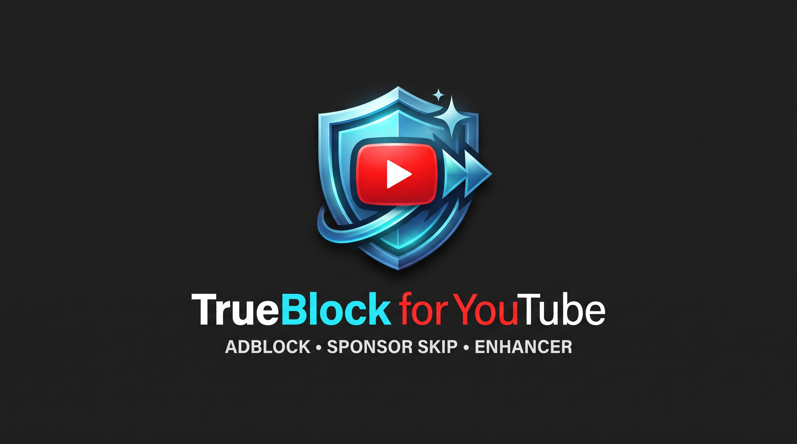

<div align="center">



**Adblock, Sponsor Skip & Enhancer — ultra-fast, privacy-first, 100% local.**

[](https://github.com/9M2PJU/trueblock-youtube-adblocker/releases)
[](https://github.com/9M2PJU/trueblock-youtube-adblocker)
[](LICENSE)
[](#-privacy)

*Skips video ads in ~50&nbsp;ms · kills banners, overlays & sponsored slots · bypasses anti-adblock walls — all running 100% locally.*

[⬇️ Install](#-install-30-seconds) · [✨ Features](#-what-it-does) · [🎨 Themes](#-themes) · [🔒 Privacy](#-privacy) · [🙏 Credits](#-credits)

</div>

---

## 🚀 Install (30 seconds)

1. Download your build from [Releases](https://github.com/9M2PJU/trueblock-youtube-adblocker/releases) and unzip it — **TrueBlock-Chrome.zip** for Chrome / Edge / Brave, **TrueBlock-Firefox.zip** for Firefox — or clone this repo.
2. Open `chrome://extensions` in Chrome / Edge / Brave (`about:debugging` → *Load Temporary Add-on* in Firefox).
3. Enable **Developer mode** (top-right toggle).
4. Click **Load unpacked** and select the extension folder.
5. Open YouTube. Pin 📌 TrueBlock to your toolbar for toggles & stats.

> Updates: repeat steps 1 + 4 (or `git pull` + click ⟳ Reload on the extension card).

### Firefox 🦊

Same codebase, verified with Mozilla's `web-ext lint`. One thing changes for Firefox: `build.sh` emits per-browser manifests — `background.scripts` (without `minimum_chrome_version`) for Firefox, and `service_worker` (without `browser_specific_settings`) for Chromium.

- **Try it now:** `about:debugging#/runtime/this-firefox` → *Load Temporary Add-on* → pick `dist/firefox/manifest.json` (lasts until browser restart).
- **Proper release:** needs signing at [addons.mozilla.org](https://addons.mozilla.org/developers/) (free account → Submit → automated checks + human review, usually days). `web-ext build` + `web-ext sign --api-key=… --api-secret=…`. Note AMO will see the honest data-use disclosure (4-char video ID hash prefixes go to SponsorBlock's API, video IDs go to RYD).

---

## 🛡️ What it does

### Ad blocking — 3 layers

| Layer | Where | What |
|---|---|---|
| **Network** | `rules/block_ads.json` | 15 MV3 `declarativeNetRequest` rules scoped to YouTube initiators block `doubleclick`, `googlesyndication`, `googleadservices`, `stats/ads`, `ptracking`, `get_midroll_` before requests leave the browser (synced with Master Pause) |
| **Player patch** | `src/inject.js` (MAIN world) | Strips `adPlacements` / `playerAds` / `adSlots` / `promotedVideoRenderer` from `ytInitialPlayerResponse` and `/youtubei/v1/*` responses via `JSON.parse` + `fetch` + `XHR` hooks, removes empty ad wrapper cards, and bridges page-world player APIs |
| **Skip + clean** | `src/content.js` (ISOLATED world) | Event-driven `requestAnimationFrame` skipper mutes + 16× + seeks active ads to end, auto-clicks every Skip variant, removes banners/masthead/overlays/sponsored slots, kills the *“Ad blockers are not allowed”* wall and resumes playback |

- Pre-roll · mid-roll · post-roll · 6s bumpers · unskippable ads → gone in a <100 ms black flash
- Sidebar / masthead / overlay / companion / in-feed ads → removed
- Sponsored Shorts → auto-skipped
- Persistent session & total counters + live badge on the toolbar icon (Master Pause disables DNR, `inject.js`, and cosmetic CSS together)

### ✨ Enhancements (all optional — on by default: volume memory, limiter, continue-skip, sponsor skip, EQ on Rock/Metal, Pure Black theme, spectrum overlay, Shorts auto-scroll)

| Group | Options |
|---|---|
| 🛡 Block | Skip video ads · remove banners & overlays · remove sponsored slots · skip sponsored Shorts · anti-adblock bypass |
| ▶ Player | Auto theater · autoplay off (both respect manual clicks/hotkeys) · remember volume / speed · force quality 4K→360p (via MAIN-world player bridge) · skip *“Continue watching?”* · remaining time · loop / timestamp / screenshot buttons · seek ±5–30 s + speed buttons · scroll-wheel volume · Shorts auto-scroll |
| 🔊 Audio | Volume boost 150 / 200 / 300 % · **audiophile 10-band EQ** (ISO bands, preamp with auto-clip-guard, global Q, 7 presets + full custom sliders) · **limiter** (−3dB/20:1 safety net) · **spectrum overlay** (live analyzer, paused in background tabs), per-video WebAudio graph that parks while paused |
| 🎨 Page | Hide Shorts everywhere · hide end cards / live chat / paid banner · hide posts, playlists, member-only, playables · videos-per-row 1–8 · unwrap redirect links + strip tracker params · block 0–9 key seeking · 11 dark themes + accent-tinted header logo + accent reset · settings Export / Import / Defaults |
| 👥 Crowd | SponsorBlock skip categories (+ colored progress-bar markers & Unskip toast button) · RYD dislike count (watch + active Shorts reel) + like-ratio bar |

### 🤝 SponsorBlock + 👍 Return YouTube Dislike (crowdsourced, on by default)

Skips **in-video** sponsor reads, intros, outros and more using the community database — clean-room client of the public hash-prefix API, no SponsorBlock code vendored:

- 8 categories: sponsor · intro · outro · subscribe-reminder · self-promo · off-topic music · recap/preview · filler (skip-type segments only)
- **k-anonymous privacy:** computes SHA-256 of the video ID locally and sends only the first **4 hex characters** to `sponsor.ajayyy.com/api/skipSegments/<prefix>`
- Auto-skips with an **Unskip** button on the toast (`Skipped sponsor (12s) · via SponsorBlock`), paints colored timeline markers on the player bar, tracks skipped segments so seeking back never loops, never fights the ad-skipper, and fails open without caching transient errors
- **Return YouTube Dislike:** appends the dislike count cleanly without overwriting the thumbs-down SVG icon, preserves YouTube's live like count, shows exact counts in tooltips, adds an optional like-ratio bar on watch pages, supports both watch pages and the active Shorts reel, and fails open offline

> Privacy note: SponsorBlock sends only a **4-character SHA-256 hash prefix** of the video ID to `sponsor.ajayyy.com`; Return YouTube Dislike sends the **video ID** to `returnyoutubedislikeapi.com`. Untick either to go fully offline.

### 🎨 Themes (v2 — rebuilt to actually stick)

- **11 presets**, default **Pure Black** (unmistakable — if it applies, you'll know)
- **Accent picker** in any color with one-click reset (`↺`) back to the active theme's default — also tints the YouTube header logo icon to match
- Hardened: controls live outside labels (no silent untick), bidirectional enforcement, doubled-specificity selectors + direct container fallbacks, and a read-back self-check that toasts a warning if your YouTube variant ignores the override

---

## 🗂️ Project layout

```
manifest.json          # MV3 manifest (min Chrome 116)
rules/block_ads.json   # network blocklist (15 YouTube-scoped DNR rules)
src/
  inject.js            # MAIN-world player/feed cleaner + player API bridge
  content.js           # event-driven ad skipper + DOM cleaner + anti-adblock
  sponsorblock.js      # hash-prefix SponsorBlock client + markers + Unskip
  ryd.js               # Return YouTube Dislike counts (original API client)
  enhancements.js      # 22 optional enhancements + v2 themes + EQ/spectrum
  content.css          # toggle-gated cosmetic ad hiding + UI helpers
  background.js        # persistent stats, DNR ruleset sync & CORS API proxy
  popup.html/.css/.js  # tabbed control panel + About & Export/Import/Defaults
tests/
  verify.mjs           # zero-dependency automated verification suite
icons/                 # toolbar icons
```

Zero dependencies. No build step for development — just load the folder. Run `bun tests/verify.mjs` to execute the test suite, and `./build.sh` to cut the per-browser store zips (`TrueBlock-Chrome.zip`, `TrueBlock-Firefox.zip`).

---

## 🔒 Privacy

- **No servers, no analytics, no telemetry.** Everything runs on-device — except **SponsorBlock** (4-char SHA-256 hash prefix of the video ID to `sponsor.ajayyy.com`) and **Return YouTube Dislike** (video ID to `returnyoutubedislikeapi.com`), both toggleable in the popup.
- Settings live in `chrome.storage` only. Nothing ever leaves your browser.
- Permissions are minimal: `declarativeNetRequest`, `storage`, `alarms`, plus YouTube, SponsorBlock, and RYD hosts only. No `declarativeNetRequestFeedback`, no `web_accessible_resources`, no `<all_urls>`, no tab reading, no history access.

---

## 🙏 Credits & ☕ Support

Free forever, no ads, no tracking. If TrueBlock saves your sanity, chip in:

[](https://paypal.me/9M2PJU)
[](https://buymeacoffee.com/9m2pju)
[](https://wise.com/pay/me/faizulz13)

- Author & maintainer: **[9M2PJU](https://hamradio.my)** — <https://hamradio.my>
- Enhancement concepts: [YouTube-Enhancer/extension](https://github.com/YouTube-Enhancer/extension) (MIT) — re-implemented natively, no upstream code vendored.
- Equalizer concept: [aashishjhaa/eq-for-youtube](https://github.com/aashishjhaa/eq-for-youtube) (no license declared — original implementation, nothing copied; standard 10-band WebAudio design).
- EQ curves informed by SFX Engine's [7 Best Equalizer Settings for Music](https://sfxengine.com/blog/best-equalizer-settings-for-music) (vocal presence, mud/sibilance control, Fletcher-Munson loudness, rock body+bite).
- In-video sponsor skipping inspired by [ajayyy/SponsorBlock](https://github.com/ajayyy/SponsorBlock) (GPL-3.0) via its public hash-prefix read API — original client code, nothing copied.
- Dislike counts via [Return YouTube Dislike](https://returnyoutubedislike.com) public read API — original client code, nothing copied.
- License: [GPL-3.0](LICENSE) — Copyright © 2026 9M2PJU. PRs welcome — especially updated selectors when YouTube moves things around (`SKIP_SELECTORS` in `src/content.js`).

## 📝 Changelog

- **v2.1.0** — MAIN-world player API bridge (fixes Force Quality, folded Autoplay, Continue Watching patch), persistent session/total counters & daily alarm fix, true Master Pause (syncs DNR ruleset, `inject.js`, and CSS flags), SponsorBlock k-anonymous hash-prefix API + timeline markers + Unskip button + seek-back guard, RYD preserves Dislike SVG icon & live Like counts, Auto-Theater respects manual toggles, event-driven ad rAF & spectrum buffer caching (lower CPU), scoped DNR rules & trimmed permissions (dropped `declarativeNetRequestFeedback`, ad host permissions, and `web_accessible_resources`), popup accent reset + Export/Import/Defaults, automated `tests/verify.mjs`
- **v2.0.0** — Popup UI/UX redesign: tabbed layout (Block · Player · Audio · Page · Crowd), switch toggles, vertical graphic EQ, dark mode; 6 new themes; header logo icon auto-tints to the theme accent
- **v1.11.0** — 6 new themes (Classic Red, Nord, Gruvbox, Tokyo Night, Solarized, Forest); popup preamp range fixed to effective values
- **v1.10.4** — Fix loud blast after pause/replay: ad-skipper restores pre-ad speed/mute/volume instead of stranding 16x, volume memory no longer unmutes burning ads, EQ enforces clip headroom (preamp + peak ≤ 0dB), audio graph parks while paused and resumes on play
- **v1.10.3** — New defaults for fresh installs: EQ on (Rock/Metal), Pure Black theme, spectrum overlay, all 8 SponsorBlock categories, Shorts auto-scroll
- **v1.10.2** — Store resubmission: version bump only (AMO validation-warning fixes shipped in v1.10.1)
- **v1.10.1** — Shorts fixes: SponsorBlock now skips segments on `/shorts/` (was watch-only), sponsored-Shorts auto-advance hardened (badge-first detect + throttle), reel ad endpoints stripped, volume/speed/EQ/timestamp tools work on the active reel
- **v1.10.0** — Return YouTube Dislike: crowdsourced like/dislike counts refill native buttons, exact totals in tooltip, optional like-ratio bar (watch + Shorts, fails open, toggle for fully offline)
- **v1.9.11** — Fix "AudioContext was not allowed to start" warning: EQ/boost/limiter graph now waits for first user gesture; no more pre-gesture resume, no muted-audio window
- **v1.9.10** — Reverted one-time autoplay heal (no 1.9.5 users exist to rescue; touch-tracking restore stands)
- **v1.9.9** — Store-submission build (per-browser manifests via build.sh)
- **v1.9.8** — Firefox-ready: gecko ID + data disclosure, background scripts fallback, 45-char name, `web-ext lint` clean
- **v1.9.7** — Toolbar icon reframed edge-to-edge (reads bigger next to other extensions)
- **v1.9.6** — New official art: blue-shield logo (extension icons rebuilt) + banner hero in README
- **v1.9.5** — Autoplay toggle is bidirectional: unticking restores Up-Next (tracked touch, manual clicks always win)
- **v1.9.4** — Official logo: red shield + play mark (16–512px, README hero)
- **v1.9.3** — 6x less CPU: skip-button scans gated behind ad detection (48ms to 8ms per 20s, measured)
- **v1.9.2** — Realtime drag safety: debounced slider writes (storage.sync quota can silently drop drag floods), flushed on release
- **v1.9.1** — Audit fixes: no more double-start counter inflation, no synthetic-ended playlist skips, absolute share links keep their origin, EQ toasts stop spamming on loudness+volume, XHR backstop arg fix, player-response seeding
- **v1.9.0** — Limiter safety net + live spectrum overlay on the player
- **v1.8.2** — Rebranded descriptor: Adblock, Sponsor Skip & Enhancer (name now matches scope)
- **v1.8.1** — EQ curves retuned per SFX Engine guide (de-mud, de-ess, sane treble) + Rock/Metal preset + dynamic loudness that flattens as volume rises
- **v1.8.0** — Audiophile EQ: 10 ISO bands, preamp with auto clip-guard, global Q, 6 presets + custom sliders
- **v1.7.1** — EQ self-reports: toasts preset/±dB on change, warns if Flat-neutral, suspended-audio, or unsupported
- **v1.7.0** — 6-band equalizer (5 presets) sharing one WebAudio graph with volume boost
- **v1.6.0** — Themes v2: rebuilt with outside-label controls, Pure Black default, bidirectional enforcement, container fallbacks, read-back self-check + toasts
- **v1.5.5** — Settings are the source of truth: theater enforced both ways (on puts it in, off keeps it out), quality re-applied persistently instead of giving up after retries
- **v1.5.4** — Unticking theater/autoplay-style modes now reverts YouTube back out (one-shot revert, no more stuck states)
- **v1.5.3** — Removed broken themes (use YouTube's native appearance settings)
- **v1.5.2** — SponsorBlock CORS fix: API fetched via background worker
- **v1.5.1** — Theme reliability: higher-specificity selectors, instant apply on setting change, toast confirmation, popup dropdowns no longer risk unticking their row
- **v1.5.0** — SponsorBlock on by default · donate buttons (PayPal · Coffee · Wise) + GitHub FUNDING.yml
- **v1.4.0** — SponsorBlock-style crowdsourced skips (8 categories, opt-in, original API client)
- **v1.3.0** — Lite themes (5 presets + accent) · seek/speed buttons · wheel volume · feed declutter · videos-per-row · link/key fixes
- **v1.2.0** — 12-feature pack: Shorts hiding, volume boost, loop/timestamp/screenshot buttons, distractions filter, remaining time, Shorts auto-scroll
- **v1.1.0** — First enhancement port: theater, autoplay-off, volume/speed memory, forced quality, continue-watching skip
- **v1.0.0** — Core MV3 ad blocker + anti-adblock bypass + About dialog
